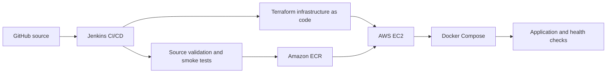

# Capstone 03 — Complete CI/CD with Terraform

**TechWorld with Nana · AI-Enhanced DevOps Bootcamp · Capstone Project 03**

> **Status:** CI pipeline implemented on a feature branch; end-to-end Terraform infrastructure provisioning and application deployment are **not verified**. Historical pipeline validation includes a successful deployment dry-run followed by a failed job due to an unset deployment-control variable. No deployment is claimed from that run.

## Project Objective

Design an automated delivery workflow using GitHub, Jenkins, Terraform, AWS EC2, Docker, and Docker Compose. Separate source validation, image build/test, artifact publication, infrastructure provisioning, application deployment, and operational verification.

This repository is the portfolio record for the project. **Intended architecture is not the same as verified implementation.**

## Intended Architecture



## Implemented Jenkins CI Workflow

The feature-branch [Jenkinsfile](Jenkinsfile) defines these stages:

1. Load a Jenkins Shared Library pinned to revision `c514371`.
2. Checkout the source revision.
3. Validate Python source syntax.
4. Build an amd64 Docker image with the Shared Library's `ecrBuild`.
5. Run a hardened temporary application container and test `/health`, `/`, and the application Git version.
6. Verify the intended AWS account and dedicated ECR publisher identity.
7. Publish an immutable Git-SHA-tagged image with `ecrPush`, and resolve its digest with `ecrImageDigest`.

**Scope limitation:** The reviewed Jenkinsfile does not include Terraform provisioning, Docker Compose rollout, or AWS SSM deployment stages. Defined stages alone do not establish that every stage has passed in a completed run. Consult the corresponding Jenkins Console Output before asserting successful execution.

## Project Status and Validation Evidence

| Area | Current documented state |
|---|---|
| GitHub repository | Created |
| Jenkins CI pipeline | Implemented in `feat/capstone03-jenkins-ci-pipeline` |
| Jenkins Shared Library | Configured with a pinned revision |
| Source validation | Defined in Jenkinsfile; completed-run evidence not consolidated here |
| Docker build and application smoke test | Defined in Jenkinsfile; completed-run evidence not consolidated here |
| AWS identity preflight and ECR publication | Defined in Jenkinsfile; completed-run evidence not consolidated here |
| Terraform deployment dry-run | Previously reported successful |
| Terraform/deployment Jenkins job | Previously reported failed after dry-run: `APPLY_DEPLOYMENT` unbound under `set -u` |
| AWS EC2 infrastructure provisioning | Not verified |
| Docker Compose application rollout | Not verified |
| End-to-end production-like deployment | Not verified |
| Official TWN review | Not verified |

### Historical Troubleshooting: Deployment Flag

A validation job reached a successful dry-run but then failed because an unset `APPLY_DEPLOYMENT` variable was referenced in a shell running with `set -u`.

For a **default-deny** deployment control, use:

```bash
APPLY_DEPLOYMENT="${APPLY_DEPLOYMENT:-false}"

if [[ "$APPLY_DEPLOYMENT" == "true" ]]; then
  echo "Deployment explicitly enabled"
  # Invoke the separately reviewed deployment process here.
else
  echo "Validation-only mode: no deployment"
fi
```

This illustrates safe handling of optional environment variables. **It is an example fix, not evidence that the historical failing job was rerun or corrected.** An actual deployment also requires authorization, reviewed infrastructure changes, and appropriate guardrails.

## Engineering Decisions and Security Practices

- **Reproducibility:** Pin the Jenkins Shared Library revision and tag images with a source-derived identifier.
- **Artifact integrity:** Verify that the published image reference matches the image tested by CI; resolve an immutable digest after publication.
- **Least privilege:** Use a dedicated AWS publishing identity rather than personal, broad administrator credentials.
- **Credential hygiene:** Bind AWS credentials through Jenkins credentials and do not commit secrets or console credentials.
- **Container hardening:** Use a read-only filesystem, a temporary writable `/tmp`, dropped Linux capabilities, and `no-new-privileges` in the smoke test.
- **Fail-fast validation:** Check source syntax, architecture, readiness, expected application responses, and cloud identity before advancing.
- **Deployment safety:** Keep deployment opt-in, separate verification from mutation, and make destructive or billable actions explicitly reviewed.
- **Traceability:** Keep Jenkins build links, sanitized console output, Git revisions, and deployment results with the portfolio evidence.

These controls are visible in the source or are documented target practices; their presence does not prove external cloud configuration or runtime security posture.

## TechWorld with Nana — Project Questions & Answers

### 1. What is the objective of Capstone 03?

To integrate continuous integration, infrastructure provisioning, and application delivery into a repeatable Jenkins-driven workflow using Terraform and AWS.

### 2. What is the role of Jenkins?

Jenkins orchestrates source checkout, validation, building, smoke testing, cloud identity preflight, and artifact publication. Infrastructure and deployment stages are part of the overall project objective but not present in the reviewed feature-branch Jenkinsfile.

### 3. Why use a Jenkins Shared Library?

It centralizes reusable pipeline functions, reduces duplicated Groovy logic, and supports consistent operations across projects. Pinning a revision improves reproducibility.

### 4. What is Terraform used for?

Terraform declaratively manages cloud infrastructure and produces a reviewable execution plan. A validated plan or dry-run does not mean resources were created.

### 5. Why use Docker and Amazon ECR?

Docker packages an application into a portable image. ECR stores versioned images for deployment. Source-derived tags and immutable digests help connect the deployed artifact to the tested source.

### 6. Why perform a container smoke test before publishing?

It checks that the image runs, reports health, serves expected responses, and exposes the intended source version. This reduces the chance of publishing an immediately broken application.

### 7. How are AWS credentials handled securely?

Use dedicated, narrowly scoped identities and Jenkins credential bindings, avoid plaintext secrets in Git, and verify the expected cloud identity before performing cloud operations. For production evolution, prefer short-lived credentials where available.

### 8. Why did the deployment validation fail after the dry-run?

The shell referenced `APPLY_DEPLOYMENT` without defining it while `set -u` was enabled. The successful dry-run did not make the later job successful.

### 9. What is the difference between validation and deployment?

Validation checks configuration or intended changes without asserting that application infrastructure was mutated. Deployment actively creates or changes cloud resources and must have separate authorization and verification.

### 10. What is still required for full Capstone 03 completion?

Consolidate passing Jenkins build evidence; validate Terraform configuration and plans; confirm authorized provisioning and Docker Compose deployment; collect application health and operational evidence; review teardown and cost controls; and complete the TWN submission requirements.

## What I Learned

- **CI versus CD:** A Jenkins pipeline can build, test, and publish artifacts successfully without deploying infrastructure or applications.
- **Pipeline modularity:** Shared Libraries are useful for repeatable container build and registry operations across projects.
- **Immutable delivery:** Git-SHA tags and image digests make it easier to identify exactly what was tested and published.
- **Secure automation:** Runtime hardening and preflight AWS identity checks are concrete safety controls, not just documentation conventions.
- **Reliable shell scripting:** Strict shell modes surface configuration errors early, while deliberate defaults avoid accidental mutation when optional flags are missing.
- **Infrastructure as Code:** A Terraform dry-run is a review checkpoint, not proof of provisioning.
- **Evidence-based reporting:** A successful individual stage and an overall failed pipeline must be reported separately. Documentation must distinguish designed, implemented, tested, and deployed states.
- **Operational maturity:** Production-quality delivery also requires least-privilege access, health checks, rollback/teardown planning, traceability, and controlled changes.

## Repository and Portfolio Links

- [Capstone 03 repository](https://github.com/asambataiden/twn-capstone-03-complete-cicd-terraform)
- [Capstone 03 Jenkins CI branch](https://github.com/asambataiden/twn-capstone-03-complete-cicd-terraform/tree/feat/capstone03-jenkins-ci-pipeline)
- [Capstone 05 portfolio](https://github.com/asambataiden?tab=repositories&q=twn-capstone-05)
- [Capstone 06 — Website Monitoring and Recovery](https://github.com/asambataiden/twn-capstone-06-website-recovery)

## Next Documentation Checkpoints

Before merging this feature branch to `main` or submitting for the bootcamp badge, attach sanitized build output and validation artifacts, reconcile the exact Terraform/deployment job script with the documented default-deny flag, and update the status table only when corresponding evidence exists. **No deployment or infrastructure teardown should be initiated merely to refresh the documentation.**
