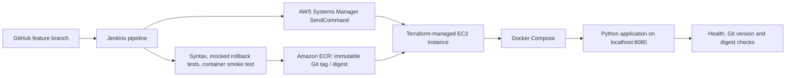

# Capstone 03 — Complete CI/CD with Terraform

**TechWorld with Nana · AI-Enhanced DevOps Bootcamp · Capstone Project 03**

> **Verified on 1 November 2026:** Jenkins-based CI, ECR publication, and opt-in EC2 deployment through AWS Systems Manager completed successfully. An independent SSM readback confirmed image digest, application version and Docker health. Five mocked deployment/rollback regression tests passed in Jenkins. **Live failure-induced rollback has not been tested.** Official TWN certificate review is not claimed.


## Engineering documentation

The [documentation hub](docs/README.md) contains detailed [system architecture](docs/architecture/architecture-overview.md), [release and rollback diagrams](docs/architecture/release-and-rollback-flow.md), [deployment runbook](docs/operations/deployment-runbook.md), [execution evidence](docs/evidence/verification-register.md), [implemented use cases](docs/learning/implemented-use-cases.md) and a prioritized [automation improvement backlog](docs/improvements/automation-opportunities.md).

## Project objective

Build a traceable CI/CD workflow for a containerized Python application using GitHub, Jenkins, a version-pinned Jenkins Shared Library, Docker, Amazon ECR, AWS Systems Manager, EC2 and Docker Compose. Provision and manage the supporting AWS environment with Terraform, while keeping infrastructure operations distinct from application delivery.

## Architecture



Terraform provisions the EC2 infrastructure as a separate infrastructure-as-code workflow. **Do not interpret the diagram as evidence that Terraform apply runs in this Jenkinsfile.** The verified pipeline primarily builds, tests, publishes and deploys the application.

## Implementation

| Component | Source / design |
|---|---|
| Application | `app/main.py`, `app/Dockerfile` (Python 3.13-slim base in observed Jenkins builds) |
| Pipeline | [Jenkinsfile](Jenkinsfile): stages gated by validation and opt-in deployment |
| Shared Library | [TWN Jenkins Shared Library](https://github.com/asambataiden/twn-devops-bootcamp-jenkins-shared-library), pinned to `c514371` |
| Deployment wrapper | [scripts/deploy-ec2.sh](scripts/deploy-ec2.sh) |
| EC2 Compose definition | [deploy/compose.ec2.yaml](deploy/compose.ec2.yaml) |
| Regression tests | [tests/test_deploy.py](tests/test_deploy.py), Python standard-library `unittest` |
| Target EC2 | `i-058aa03bdbb014833` in `eu-north-1` |
| ECR repository | `591132357918.dkr.ecr.eu-north-1.amazonaws.com/twn-capstone-03-app` |

### Verified CI/CD stages

1. Load the Shared Library at a fixed revision, then checkout source.
2. Check Python source syntax and Bash deployment-script syntax.
3. Run five isolated deployment/rollback regression tests using mock Docker, AWS and HTTP commands.
4. Build the `linux/amd64` image and run a hardened ephemeral container smoke test of `/`, `/health`, and the Git version.
5. Validate AWS account and dedicated ECR publisher principal.
6. Publish a Git-SHA-tagged image to ECR, or explicitly reuse an existing immutable tag; resolve its digest.
7. Deploy **only when** `DEPLOY_TO_EC2=true` using a separate, restricted SSM deployer identity.
8. On EC2, use instance-role authentication for image pulls, Docker Compose health checks, application version matching and image reference validation.

**Jenkins parameters:** `DEPLOY_TO_EC2=false` by default; `REUSE_PUBLISHED_IMAGE=false` by default. Reuse requires a previously published tag for the *current* Git commit. A successful redeploy with the same digest does not mean the application image bytes changed.

### Security and release decisions

- Store separate ECR publisher and SSM deployer credentials in Jenkins; the EC2 instance uses its own IAM role for ECR pulls.
- Scope the deployer to the intended SSM target; remember that `AWS-RunShellScript` grants the ability to execute commands on that target.
- Keep deployment opt-in and forbid concurrent builds.
- Resolve and deploy an immutable `@sha256:` reference; record the source revision separately.
- Use a local-only application port (`127.0.0.1:8080`), a read-only container filesystem, dropped capabilities and `no-new-privileges`.
- Capture a healthy prior deployment before mutation; on failed rollout or release verification, attempt to restore the previously verified digest and version. Fail the Jenkins job even when rollback succeeds.
- Test failure paths in an isolated mock environment before risking application availability.
- Treat automated rollback as a best-effort recovery mechanism, **not** proof of zero downtime, availability during rollback, or successful recovery from all failures.

## Verified execution evidence

| Checkpoint | Evidence | Result |
|---|---|---|
| Jenkins CI-only quality gate | Commit `84a74d8a7966`; five regression tests and image smoke tests passed; image published to ECR; CD stage skipped | SUCCESS |
| Jenkins-triggered hardened release | SSM Command ID `80c32db2-afb6-41a4-b11f-0bc333591541`; status `Success`, remote exit `0` | SUCCESS |
| Independent post-deployment check | SSM Command ID `bf59b16b-5de3-428f-8120-0c481d91d857`; status `Success`, exit `0`, no stderr | SUCCESS |
| Running container | `capstone03-app-1`, health `healthy` | VERIFIED |
| Application version | `84a74d8a7966` via localhost JSON endpoint | VERIFIED |
| Running image | `sha256:8a28d96d32b94457c37ceaf888f472bc1ac529e1cb5f85236db534d00290064d` | VERIFIED |
| Rollback scenarios | Five mocked `unittest` cases, passing locally and in Jenkins | PASS (MOCKED) |
| Forced live rollback | No failure-injection execution supplied | NOT VERIFIED |
| TWN certificate approval | No official reviewer confirmation supplied | NOT VERIFIED |

The image digest also appeared in earlier releases because the application image contents were unchanged. `APP_VERSION` records the Git commit of the rollout, not a cryptographic property of the image itself.

## Deployment and safe validation

For a CI-only run, leave `DEPLOY_TO_EC2=false`. Use `REUSE_PUBLISHED_IMAGE=false` only when the commit's immutable tag has not already been published. For an authorized redeploy of a published commit, set both `DEPLOY_TO_EC2=true` and `REUSE_PUBLISHED_IMAGE=true`, after reviewing the image digest and target.

Local, non-deployment checks:

```bash
bash -n scripts/deploy-ec2.sh
python3 -m unittest discover -s tests -p 'test_deploy.py' -v
git diff --check
```

Inspect current release using a **read-only** AWS SSM check and compare three independent signals: Docker `Config.Image` digest, Docker health state and application `version`. Never treat a successful SSM submission alone as verified runtime health.

## Troubleshooting and limitations

- **Unbound deployment flag under `set -u`:** A historical job failed after a successful dry run because `APPLY_DEPLOYMENT` was unset. Explicitly default optional flags or use Jenkins boolean parameters; a passing stage does not override a failed job.
- **Immutable ECR tag already exists:** Reuse the published image explicitly after confirming its provenance rather than attempting to overwrite the tag.
- **Wrong or missing AWS identity:** Validate the specific caller and account, and separate publisher, deployer and EC2 pull permissions.
- **Deployment failure:** Check the SSM command invocation output and exit code; distinguish `ROLLBACK SUCCESS` from `ROLLBACK FAILED`. A rollback that recovers service still means the requested release failed.
- **Previous application unhealthy:** The current rollback design refuses to start a new deployment unless it can establish a healthy baseline.
- **Rollback boundaries:** Recovery requires the prior image to remain locally available and its configuration to be compatible. No production-grade zero-downtime strategy or live rollback proof is claimed.
- **Credential warning during Docker ECR login:** Docker may warn about temporary credential storage. The scripts use a temporary `DOCKER_CONFIG` with cleanup; do not expose registry tokens in build logs.

## TechWorld with Nana — Project Questions and Answers

### 1. What was the objective of Capstone 03?
To connect infrastructure management with a repeatable application CI/CD pipeline, automating source validation, container testing, artifact publication and remote EC2 deployment.

### 2. What did I implement in Jenkins?
A parameter-gated pipeline using a pinned Shared Library, source validation, five rollback regression tests, Docker build/smoke tests, scoped AWS authentication, ECR publication and SSM-based EC2 deployment.

### 3. What is Terraform responsible for?
Provisioning and managing the AWS infrastructure declaratively. It has a separate lifecycle from the Jenkins application release pipeline; the observed Jenkinsfile does not perform `terraform apply`.

### 4. Why use a Jenkins Shared Library?
To centralize reusable ECR image operations and SSM deployment orchestration. A fixed Shared Library revision makes builds more reproducible and auditable.

### 5. Why use both Git tags and image digests?
Git-SHA-derived tags link ECR artifacts to release metadata, while the image digest identifies the exact immutable container artifact. Two Git revisions can point to the same digest when the Docker build context is unchanged.

### 6. Why test the container before publishing?
The smoke test checks architecture, readiness, HTTP endpoints and the reported version before ECR publication or EC2 deployment.

### 7. How are cloud credentials separated?
The publisher can publish to ECR, the dedicated SSM identity submits targeted deployment commands, and the EC2 instance role pulls images. Broad personal AWS credentials are not required by the Jenkins workflow.

### 8. How is deployment approval controlled?
`DEPLOY_TO_EC2` defaults to false, and the CD stage executes only with explicit opt-in. Image reuse is separately controlled.

### 9. What happens when a deployment or version check fails?
The script attempts to restore the last healthy image and version and verifies recovery. It still exits nonzero so Jenkins records failure. Live rollback under an injected EC2 fault has not been demonstrated.

### 10. What is the difference between a successful SSM command and a verified release?
SSM success proves remote command completion. Release verification also checks the running image digest, application version and container health. The latter was independently confirmed using a second SSM command.

### 11. What did the deployment regression tests validate?
Five mocked scenarios: successful release, version mismatch rollback, health failure rollback, rollback failure reporting and rejection of an unhealthy baseline.

### 12. What remains before claiming production readiness?
Live failure-path validation in an isolated nonproduction environment, more robust observability and notifications, disaster-recovery design, secret/role rotation or temporary credentials, provenance verification for reused artifacts, and security/cost review.

## What I Learned

- **CI and CD have different safety boundaries.** Source tests and image publishing can run without touching EC2; deployment must be explicitly authorized.
- **A pipeline needs failure-path testing.** The five mocked cases exposed recovery behavior that a happy-path health check alone cannot establish.
- **Use immutable artifacts.** Deploying an ECR digest removes ambiguity from mutable image tags.
- **Track release metadata separately from image content.** Git revisions identify pipeline changes even when the application image digest remains unchanged.
- **Least privilege is role-specific.** Jenkins publishing, Jenkins SSM orchestration and EC2 image pulls require different rights.
- **Infrastructure and delivery are not interchangeable.** Terraform manages infrastructure; the verified Jenkinsfile deploys onto existing infrastructure.
- **Operational evidence must be independent.** A second, read-only SSM invocation confirmed runtime health, image digest and application version after Jenkins reported success.
- **Recovery must fail visibly.** Restoring the old release must not allow a broken requested deployment to appear successful in Jenkins.
- **Documentation must reflect verified outcomes.** Mock tests, successful remote deployment, independent verification and untested live rollback are distinct claims.

## Portfolio resources

- [Capstone 03 repository](https://github.com/asambataiden/twn-capstone-03-complete-cicd-terraform)
- [Capstone 03 feature branch](https://github.com/asambataiden/twn-capstone-03-complete-cicd-terraform/tree/feat/capstone03-jenkins-ci-pipeline)
- [Reusable Jenkins Shared Library](https://github.com/asambataiden/twn-devops-bootcamp-jenkins-shared-library)
- [Capstone 06 — Website Monitoring and Recovery](https://github.com/asambataiden/twn-capstone-06-website-recovery)

Before merging to `main` or applying for a badge, review this README against the infrastructure code, preserve sanitized Jenkins/SSM logs as evidence, check that no credentials are committed, and confirm repository visibility and TWN submission requirements.
