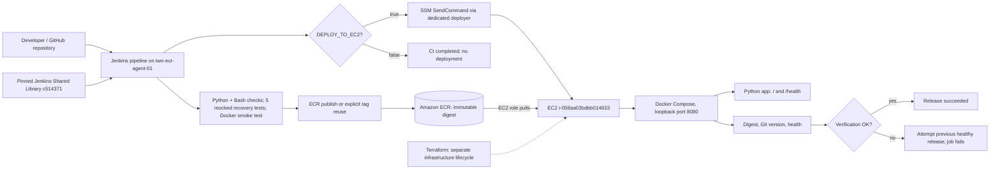
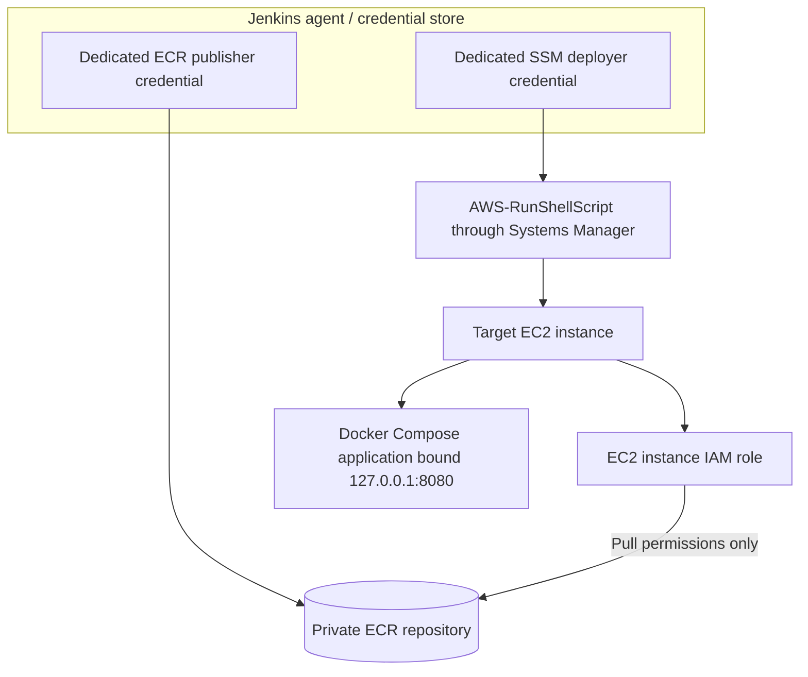

# Architecture overview — Capstone 03

**Status:** Verified application CI/CD, Terraform-managed target infrastructure, and documented manual controls. As of 1 November 2026.

## System architecture (implemented)

The Terraform line is dashed intentionally. Existing infrastructure was managed with Terraform, but the verified application pipeline does not execute a Terraform plan or apply.

## Identity and trust boundaries

**Observed/defined controls:** separate publishing and deployment principals, target-scoped SSM access, EC2 ECR pull role, opt-in deployment, immutable image references, dropped container capabilities, read-only container root filesystem and localhost binding.

**Security caveat:** Systems Manager RunShellScript still provides powerful command execution on the target; the Jenkins UI was observed accessed via plain HTTP on a public IP. Prioritize restricted access and HTTPS, without publishing credentials or sensitive config.

## Files and responsibilities

| File | Responsibility |
|---|---|
| [Jenkinsfile](../../Jenkinsfile) | Jenkins CI stages, ECR release and opt-in deployment |
| [deploy/compose.ec2.yaml](../../deploy/compose.ec2.yaml) | EC2 application security and health settings |
| [scripts/deploy-ec2.sh](../../scripts/deploy-ec2.sh) | Remote deployment and best-effort rollback |
| [tests/test_deploy.py](../../tests/test_deploy.py) | Mocked deployment / rollback checks |

## Artifact identity nuance

The deployment validated on 1 November used version `84a74d8a7966` with digest `sha256:8a28d96d32b94457c37ceaf888f472bc1ac529e1cb5f85236db534d00290064d`. Earlier Git revisions also resolved to this digest because the application build context did not change. Application version is runtime metadata; it is not independent proof of the image source.
