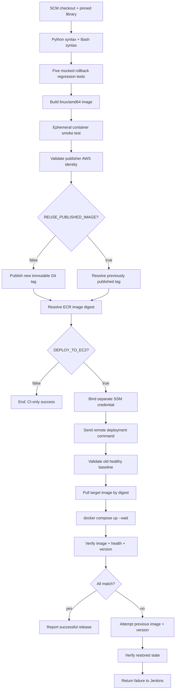
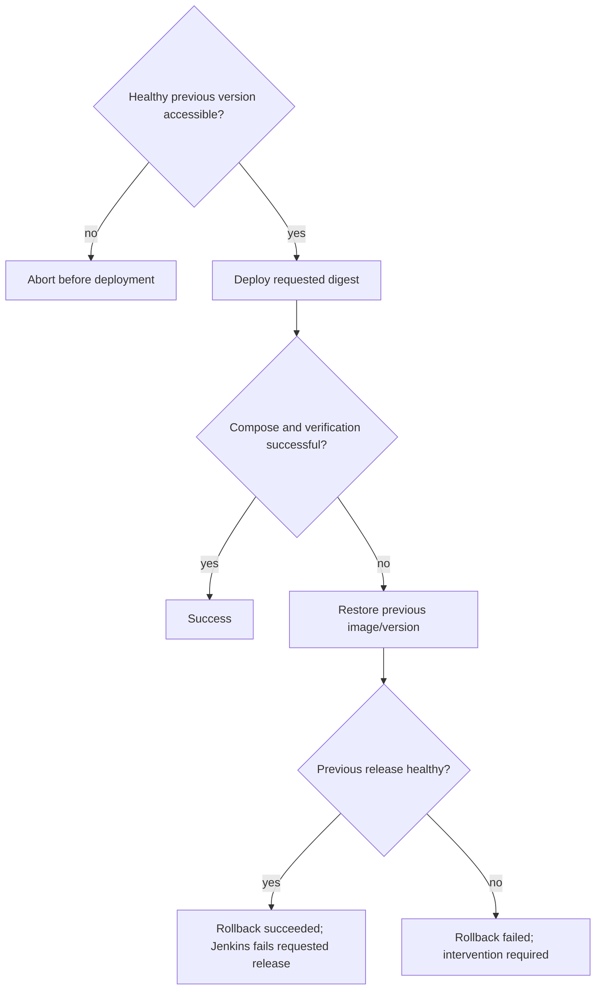

# CI/CD and rollback flows

## Delivery sequence (implemented)

## Recovery boundary

**Verified:** normal deployment and release readback. **Mock-tested:** successful rollout, version mismatch recovery, health failure recovery, rollback failure detection, and unhealthy baseline rejection. **Not verified:** live injected failure and recovery, zero-downtime service, disaster recovery.

## Engineering caution

Image pull and initial ECR authorization occur before the rollback subshell. The implementation aims to avoid changing the running workload when an image is unavailable, but does not claim recovery from every host, Docker, disk, or network failure. Multiple concurrent external deployers must be prevented independently of Jenkins' `disableConcurrentBuilds()`.
